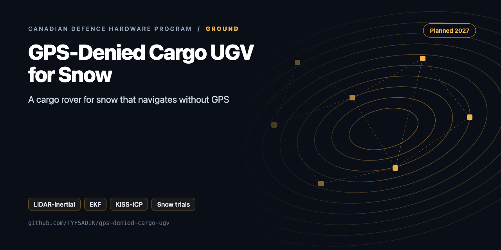
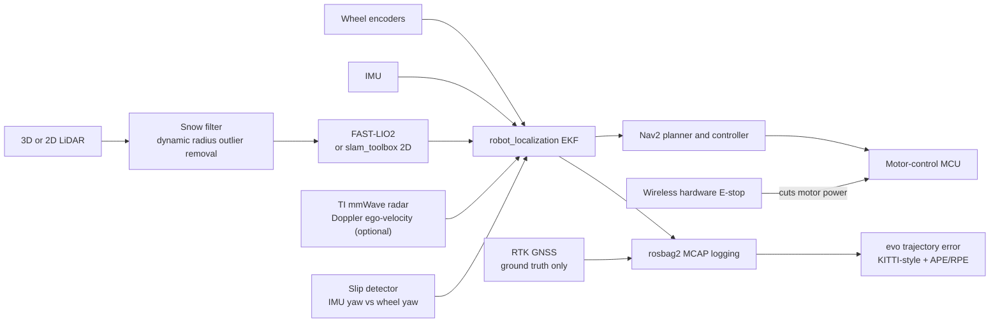

<div align="center">



# GPS-Denied Cargo Ground Vehicle for Snow

**Build guide for a GPS-denied cargo ground vehicle for snow: LiDAR-inertial odometry, EKF slip handling, payload and energy sweeps, and honest spec-gap tables.**

[](https://github.com/TYFSADIK/gps-denied-cargo-ugv/actions/workflows/tests.yml)   [](LICENSE) [](https://github.com/TYFSADIK/defence-hardware-program)

[Build guide](docs/project-page.md) · [How it works](#how-it-works) · [Quick start](#quick-start) · [Program hub](https://github.com/TYFSADIK/defence-hardware-program)

</div>

## Overview

This is a planned build guide for a small GPS-denied cargo ground vehicle tested on snow: a ROS 2 rover that fuses wheel encoders, an IMU, and LiDAR-inertial odometry through an EKF, measures its own navigation error, wheel slip, and energy use at 10-30 kg payloads, and scores every run against RTK GNSS carried only as ground truth.

The yardstick is real: two MINERVA ground challenges, a cargo uncrewed ground system and a surveillance uncrewed ground system, were published through Innovative Solutions Canada and closed in September 2026. They read like engineering specs, not marketing: carry 140 kg, tow 275 kg, hold 7 km/h cross-country with rated payload, climb 20% grades, run from -20 to +40 C. Those challenges are closed to new proposals, so this page uses them as spec sheets the way the Arctic UAS page uses its closed challenge: a published, measurable target to build against.

Scope honesty up front: **nothing on this page is built or tested yet**. A solo bench build cannot meet a 140 kg payload or a 410 kg vehicle class, and this guide does not pretend otherwise. What it can do is build the navigation-and-energy core at hobby scale, measure it honestly on pavement, gravel, and real southern Ontario snow, and publish a gap table that says exactly which spec lines were met, partly tested, or never touched. The output is scaling arguments and data, not a compliance claim.

## How it works



## Quick start

```bash
pip install -r requirements.txt
python demo.py && python -m unittest -v
```

Real output from the demo, run on simulated data:

```text
DROR: removed 100% of snow, kept 100% of wall
radar ego-velocity [2.005 0.087] (true [2.  0.1]), 70/80 inliers, sigma [0.004 0.007]
slip=0.66 spinning=True wheel sigma=2.08 m/s
energy model R^2=0.992
   {'requirement': '4 h @ 15 km/h unladen, paved, -20 C', 'achieved_h': 1.21, 'needed_h': 4.0, 'battery_needed_wh': 6603}
   {'requirement': 'cross-country 140 kg @ 7 km/h, loose snow, -20 C', 'achieved_h': 1.13, 'needed_h': 4.0, 'battery_needed_wh': 7090}
```

## What's in this repo

| File | Purpose |
|---|---|
| `ugv/snow_filter.py` | **DROR** (Charron et al. 2018): range-scaled radius outlier removal for falling snow, run before odometry |
| `ugv/radar_ego.py` | mmWave **Doppler ego-velocity** with RANSAC (rejects moving vehicles). Keeps working when LiDAR degrades in snow |
| `ugv/slip.py` | Slip ratio from wheel vs ground velocity, and wheel-odometry variance that grows with slip |
| `ugv/energy.py` | Wh/km model (payload, temperature, surface: paved, gravel, packed, loose), endurance and stationary hours, spec check |
| `config/kiss_icp_snow.yaml` | KISS-ICP settings for snow (min range cuts the near-sensor halo) |

## What you need

- ROS-compatible 4WD or tracked research chassis, with the payload rating checked against the 30 kg sweep top end.
- RTK GNSS pair (rover and base), used as ground truth only.
- A good IMU.
- 3D LiDAR, or a 2D LiDAR for the slam_toolbox fallback.
- Wheel encoders, if the chassis does not include them.
- Wireless E-stop relay on the motor power line.
- Battery sized from the Phase 5 stationary-energy result, not before it.
- TI mmWave radar evaluation board for Doppler ego-velocity.

## Spec gaps

How the hobby build compares with the requirement it is built against:

| Spec line | Hobby-scale status |
|----|----|
| Full system (vehicle + payload + GCS + radio + multi-battery charger + 100 m remote antenna) | Partial: rover, laptop GCS, and RTK base planned; charger and remote antenna not yet specced |
| -20 to +40 C operation | Partial: southern Ontario winter tests Dec-Mar; only actually tested temperatures will be reported, +40 C not tested |
| 410 kg unladen cap | Not comparable: hobby chassis is far below the cap |
| 15 km/h and 4 h unladen | Not tested: speed is capped for safety at this scale |
| Paved, sand, gravel, day/night, 15 degree gradients | Partial: pavement, gravel, and snow planned; gradients only if a safe test site allows |
| 7 km/h cross-country with rated payload | Not comparable: payload is 10-30 kg, not the rated 140 kg |
| 20% grades, 15% side slopes, 250 mm step, 500 mm trench | Not tested |
| Carry 140 kg incl. tri-wall container; tow 275 kg | Not met: scaling argument only, from the Phase 4 payload sweep |
| Radio radius 5 km with live video / 10 km autonomous (cargo); 3 km (surveillance) | Not tested |
| Person/vehicle recognition ranges, 1 m obstacle look-over, 180 degree pan | Not applicable: this build is the navigation and energy core, no recognition payload |
| 48 h stationary endurance on sensor payload | Planned: Phase 5 with a 30 W resistive load (1.44 kWh est. payload budget) |
| Room/power/API for a 100 lb, 30 W payload | Partial: the 30 W load test mirrors the power line; room and API not tested |
| \$150,000 cost | Argued only via bill of materials plus a scaling argument |
| 5 dB SPL at 500 m; fibre-optic control; NATO tow hook; PLS deck; 30 min readiness | Not tested |
| GCS with mission sim, MGRS, TAK push, return-on-link-loss | Planned: mission sim via Gazebo; TAK push intended through the common-operating-picture work; MGRS and link-loss return not yet specced |

## What gets measured

- Translation error as percent of distance travelled, KITTI-style over 100-800 m segments, per surface and per sensor set.
- APE and RPE from evo for every logged run, against RTK ground truth.
- Slip ratio over time, slip-detector triggers, and correlation with stuck events.
- Stuck events per kilometre, by surface and snow condition (depth, packed vs loose).
- Wh/km across the 0/10/20/30 kg payload sweep, per surface.
- Maximum stable speed per payload and surface.
- LiDAR odometry loss-of-track events versus snowfall intensity, with and without the snow filter and radar velocity.
- Stationary endurance: hours sustained on the 30 W load plus compute, and the battery's measured cold derating.

## Status

- **Now to December 2026**: Phase 0 simulation (Gazebo slip terrain, EKF + Nav2, evaluation scripts), per the program calendar that puts software and simulation work in the fall.
- **December 2026 to March 2027**: the southern Ontario snow window: bench bring-up first, then Phase 2 baseline loops, Phase 3 winter runs, and the Phase 4 payload sweep while the snow lasts.
- **Spring 2027**: Phase 5 stationary energy and the Phase 6 report with the full dataset and an updated, measured spec-gap table.
- **Programs to watch**: the MINERVA challenges run through Innovative Solutions Canada (the two ground challenges used here as spec sheets closed in September 2026; further challenges are released progressively), and the IDEaS program, whose counter-drone sandbox and competitive projects are the natural home for measured, honestly scoped work like this. Any application would need the business-readiness basics first: incorporation, Controlled Goods Program status, and the CPCSC Level 1 self-assessment.

## Related builds

- [**Canadian Defence Hardware Program**](https://github.com/TYFSADIK/defence-hardware-program), the hub page: how this build fits the MINERVA challenges and the rest of the bench.
- [GPS-Denied Navigation Rover](https://github.com/TYFSADIK/gps-denied-navigation-rover), the sibling rover work whose sensor-fusion lessons feed this testbed directly.
- [Thermal Search-and-Rescue Drone](https://github.com/TYFSADIK/thermal-sar-drone), the air-side build against the companion MINERVA Arctic UAS spec.
- [Secure Fleet Updates](https://github.com/TYFSADIK/secure-fleet-updates), the signed A/B update flow this rover inherits once it joins the fleet.
- [Multi-Domain Common Operating Picture](https://github.com/TYFSADIK/multi-domain-common-operating-picture), where this rover's position and health data land once the fusion layer is live.

## Safety and legal

**Physical safety:** a hardware E-stop that cuts motor power, a software speed cap, a private test area, and a spotter for every outdoor run. The E-stop is verified on blocks in Phase 1 before the rover ever drives under its own power off the bench.

**Battery discipline:** batteries charge indoors and never below 0 C; a pack coming in from a winter test warms to room temperature before the charger connects.

**Legal:** check municipal bylaws before running a ground robot in any public or semi-public space, and test only on private property with permission. This build is defensive and civilian in character: it surveys and hauls, and carries nothing that jams, spoofs, or harms.

## Learn more

The full build guide, with step-by-step instructions, wiring, troubleshooting and lessons learned, is in [docs/project-page.md](docs/project-page.md). It is also published at [tyfsadik.org](https://tyfsadik.org/work/defence/gps-denied-cargo-ugv.html).

## License

[MIT](LICENSE). Built by [Taki Sadik](https://tyfsadik.org) as part of the self-funded [Canadian Defence Hardware Program](https://github.com/TYFSADIK/defence-hardware-program).
